

# Prime Rental platform

**A full-stack car rental platform I designed and built for a multi-branch rental company in Accra, Ghana: online booking, Mobile Money payments and live GPS fleet tracking.**

[Demo video](assets/prime-rental-demo.mp4) · [Engineering highlights](#engineering-highlights) · [How it works](#how-it-works) · [Contact](#contact)

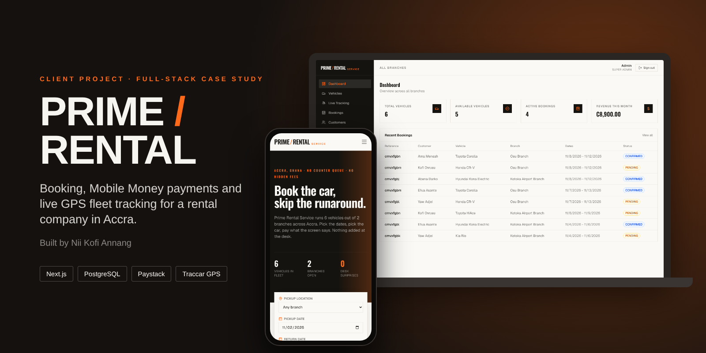

> This is a portfolio showcase of my work. The source code is private, and nothing here is open for reuse. See [All Rights Reserved](#all-rights-reserved).

## The brief

Prime Rental Service rents cars from two branches in Accra: Osu and Kotoka International Airport. Bookings ran over phone calls, WhatsApp and spreadsheets. Customers couldn't see what was available or what they'd pay until they reached the desk. There were no online payments, although most customers prefer Mobile Money. The owner had no view of where cars were once they left the lot, and each branch kept its own records, which led to double bookings and revenue that was hard to reconcile.

## What I built

One Next.js application with two sides:

- **A public storefront**, built mobile-first. Customers search by branch, dates, category and price and see only cars that are actually free. They can return to a different branch, see the full price before checkout, pay by card or Mobile Money (MTN MoMo, Telecel Cash, AirtelTigo), and manage their bookings in an account area.
- **An admin console** for staff. It has a dashboard of key numbers, booking management through the full lifecycle, fleet and maintenance records, revenue and utilisation reports, staff accounts, an activity log, and a live GPS map of the fleet with a remote engine cut-off.

## Engineering highlights

- **No double bookings.** Availability is worked out on the server with an interval-overlap query against bookings that still hold a car (pending, confirmed or active). It's backed by a composite index on vehicle and date range. The browser never decides what's available.
- **Payments that hold up when things go wrong.** Paystack's hosted checkout means card details never touch the app. A signed webhook is the main confirmation path, because the redirect back to the site can fail. The signature is checked with HMAC-SHA512 and a timing-safe comparison. Every payment is re-checked with Paystack on the server and the amount is compared with the booking total. Confirmation is idempotent, so the redirect and the webhook can both arrive but the payment is recorded once. The payment and booking status update together in one database transaction.
- **Prices fixed at booking time.** Each booking keeps a copy of the daily rate, so later price changes never affect existing bookings.
- **A remote engine cut-off with a safety guard.** The server refuses an engine-stop command unless the vehicle's last known speed is near zero (3 km/h or less). Every attempt, including refused ones, is logged with who asked, why, and the speed at that moment.
- **Connecting to GPS hardware without coupling to it.** The trackers (MiCODUS MV710G) report to a self-hosted Traccar server, and the app only calls Traccar's REST API. Tracker protocols stay out of the serverless app, and hardware can be swapped without code changes.
- **Branch-level access control.** There are four roles: super admin, branch manager, front-desk staff and customer. A single helper limits every admin query for managers and staff to their own branch.
- **Graceful fallbacks.** The payment and GPS clients return results instead of throwing errors. If an integration isn't configured, checkout falls back to a clearly labelled demo payment and the tracking page shows a setup guide.
- **Audit trail.** Bookings, status changes, staff changes and other sensitive actions are recorded with who did what and when.

## Walkthrough

**Renter: search → pick a car → see the total**

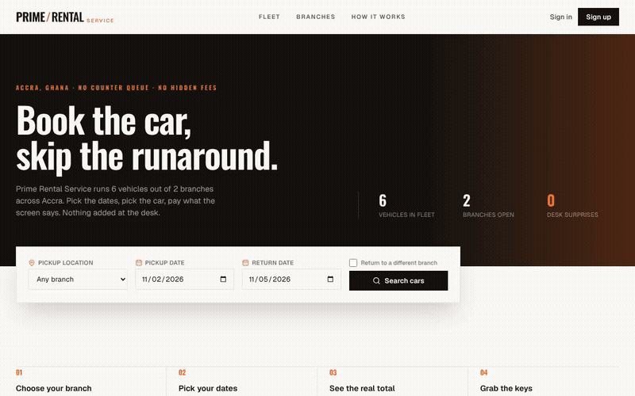

**Staff: sign in → bookings → live tracking → reports**

▶️ **[Watch the full 40-second demo video](assets/prime-rental-demo.mp4)**

## Screenshots

| Home & search | Fleet results |
| --- | --- |
| 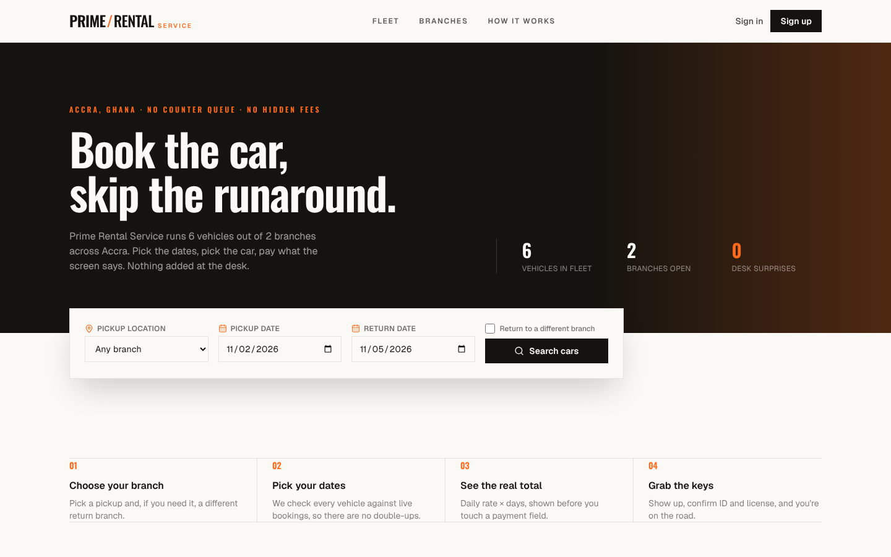 | 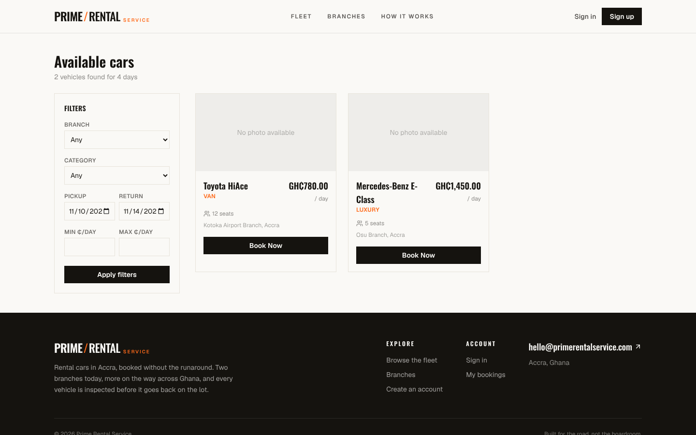 |

| Car detail & live price | Admin dashboard |
| --- | --- |
| 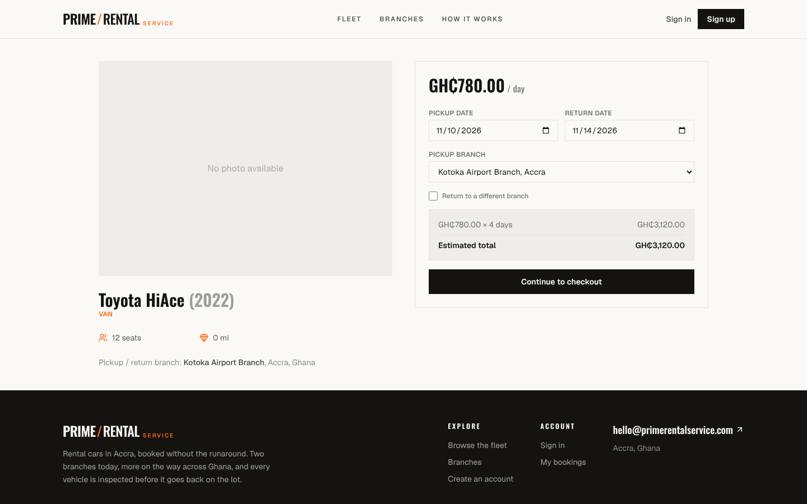 | 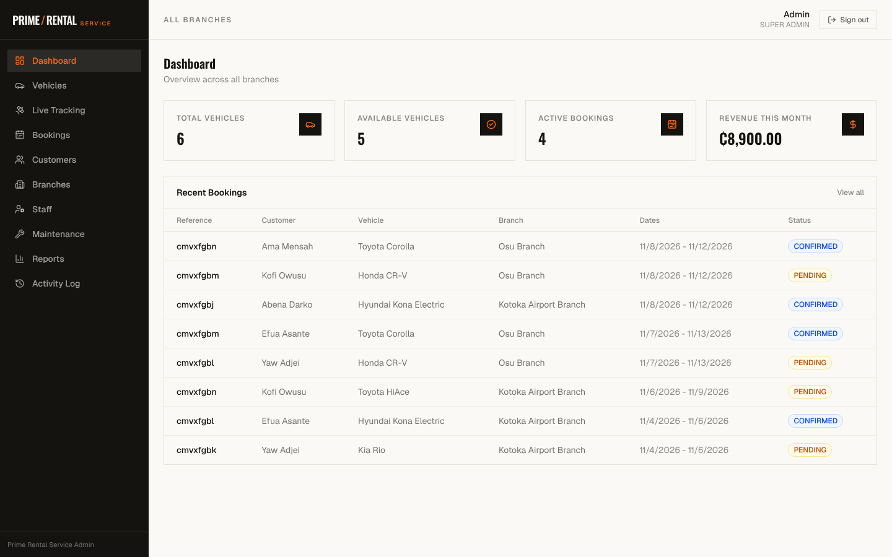 |

| Live GPS tracking | Bookings |
| --- | --- |
| 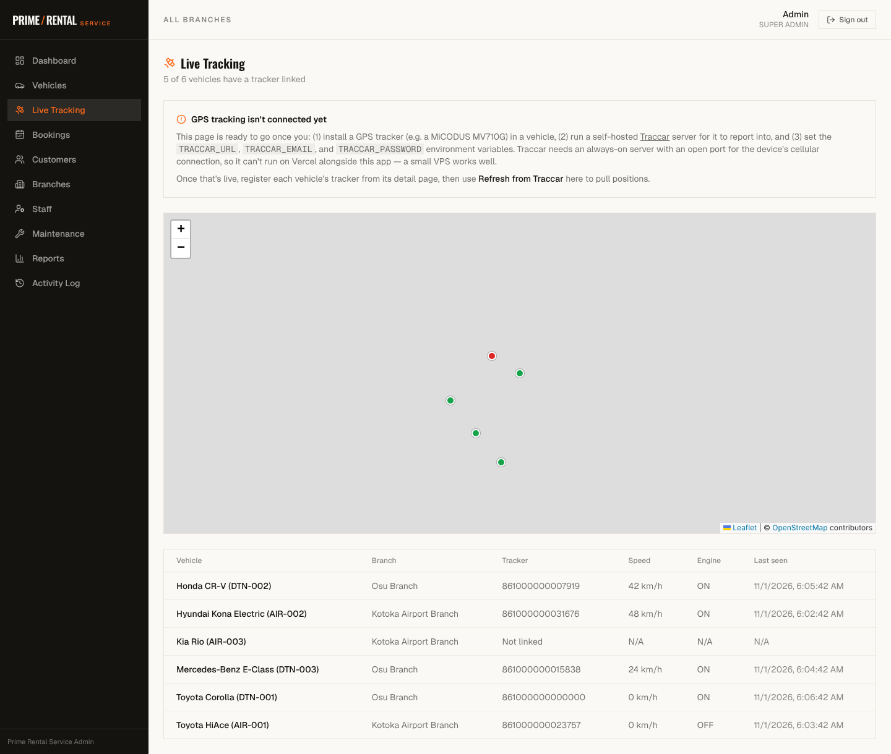 | 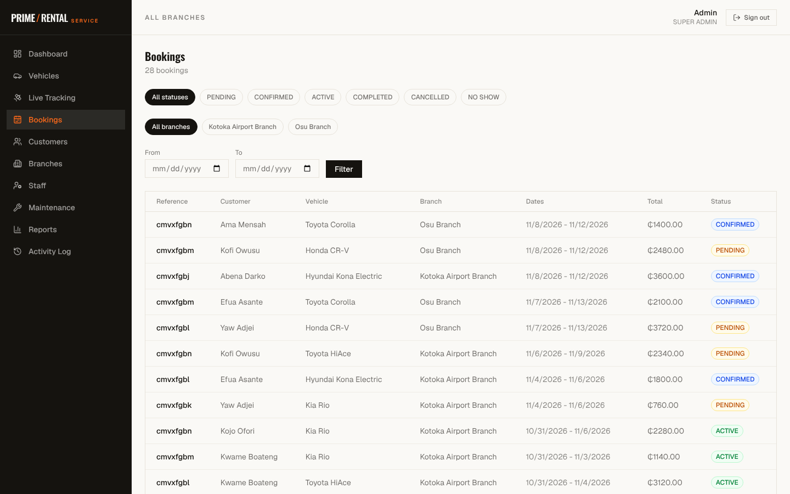 |

| Fleet management | Reports |
| --- | --- |
| 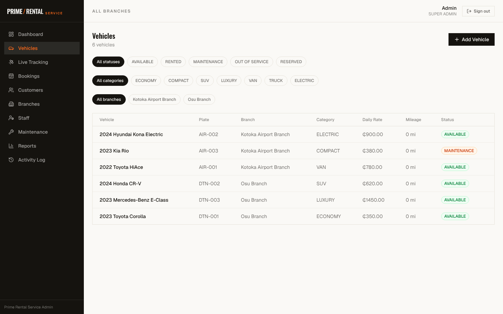 | 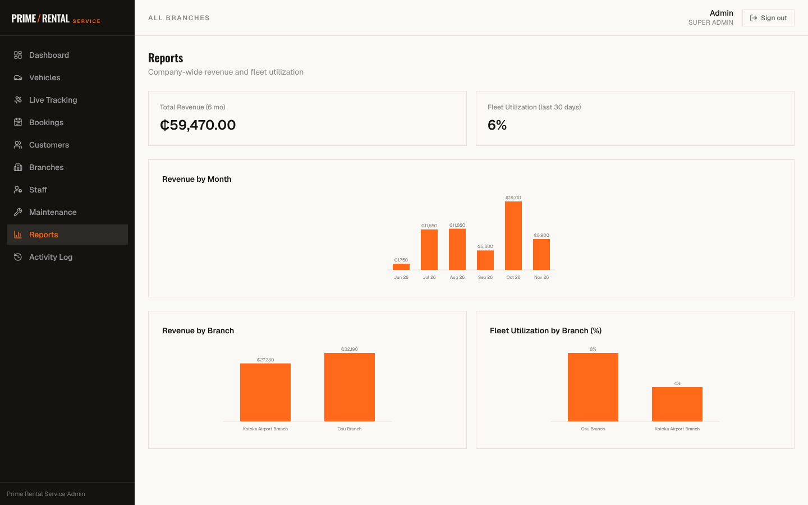 |

| Maintenance | Activity log |
| --- | --- |
| 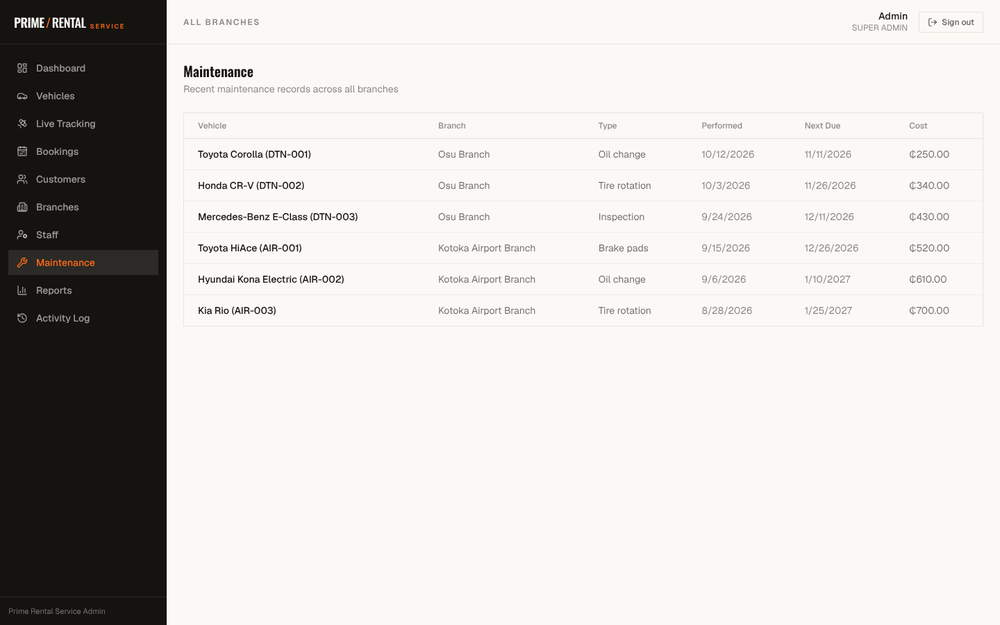 | 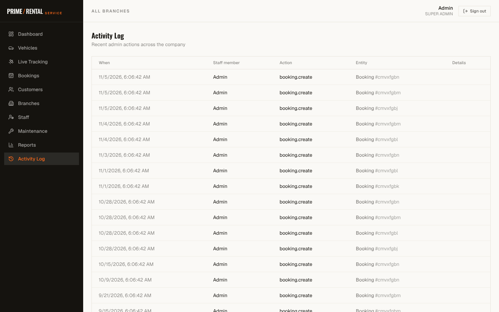 |

| Mobile home | Mobile fleet |
| --- | --- |
| 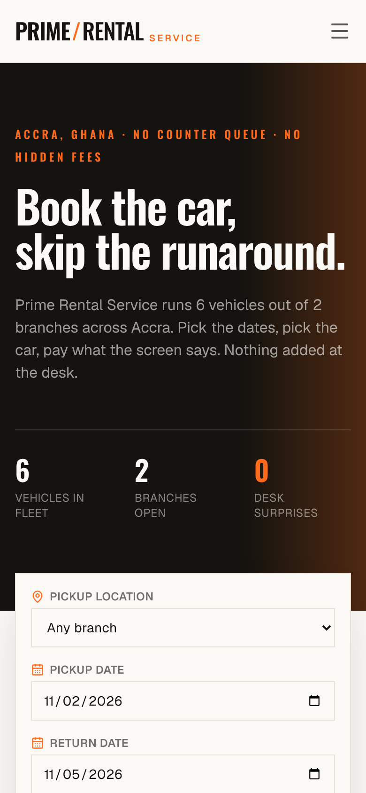 | 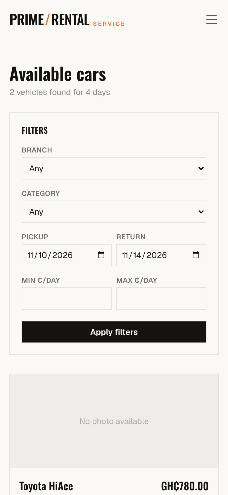 |

These were captured from the app running with sample data, not the client's real customers or bookings. The tracking map's background tiles weren't available in the capture environment.

## How it works

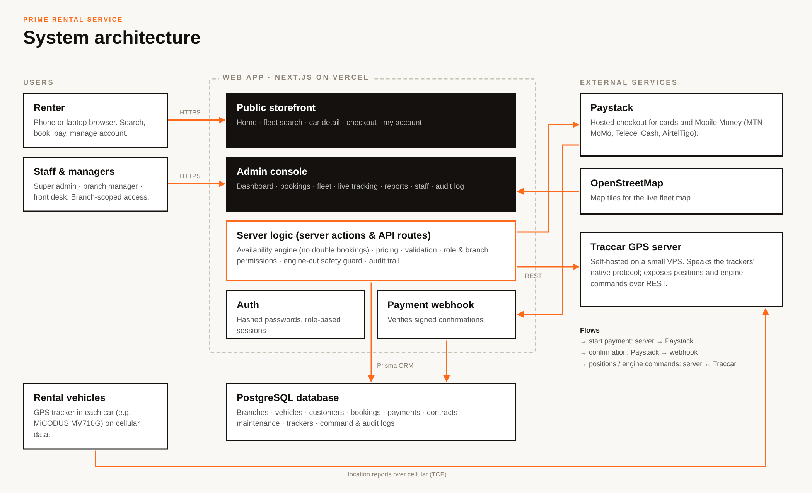

1. Renters and staff use one Next.js app, deployed on Vercel.
2. All business rules run on the server: availability, pricing, permissions and the engine cut-off guard.
3. PostgreSQL, accessed through Prisma, holds all the data.
4. Payments go through Paystack's hosted checkout and are confirmed by a signed webhook.
5. GPS trackers report to a self-hosted Traccar server, and the app reads positions and sends engine commands through Traccar's API.

## Tech stack

| Area | Technology |
| --- | --- |
| Framework | Next.js 16 (App Router, Server Components, Server Actions), React 19, TypeScript |
| Styling | Tailwind CSS 4, Lucide icons |
| Data | PostgreSQL, Prisma ORM |
| Auth | Auth.js (NextAuth v5), bcrypt, role-based sessions |
| Validation | Zod, React Hook Form |
| Payments | Paystack: cards and Mobile Money |
| GPS | Traccar (self-hosted), MiCODUS MV710G trackers |
| Maps | Leaflet, OpenStreetMap |
| Hosting | Vercel, managed Postgres, small VPS for Traccar |

## My role

I was the sole developer. I handled the data model, backend, both frontends, the payment and GPS integrations, deployment and ongoing fixes, working directly with the client.

## Contact

- **GitHub:** [@7kbytes](https://github.com/7kbytes)

## All Rights Reserved

© 2026 7Kbytes. All Rights Reserved. Nothing in this repository may be copied, modified, distributed or reused without prior written permission. The Prime Rental Service name and branding belong to their owners and are shown for presentation only. See [LICENSE](LICENSE).
